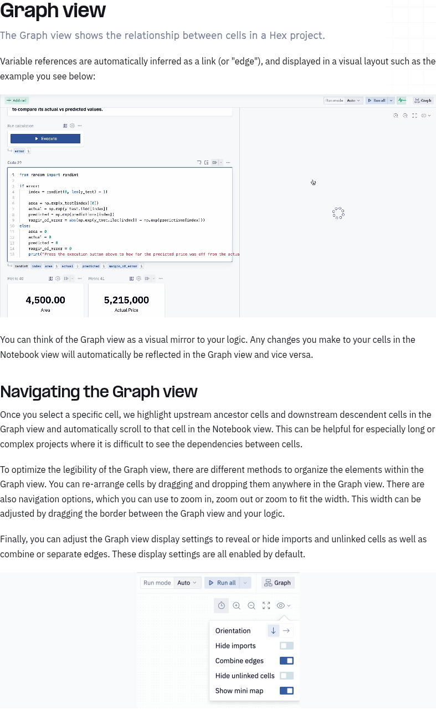
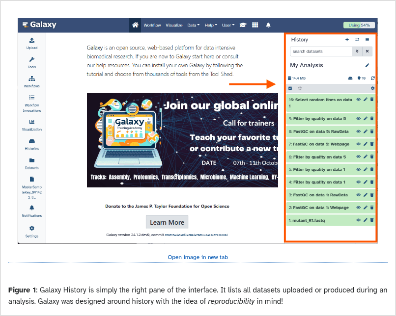
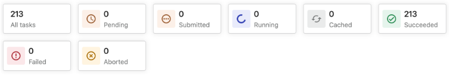
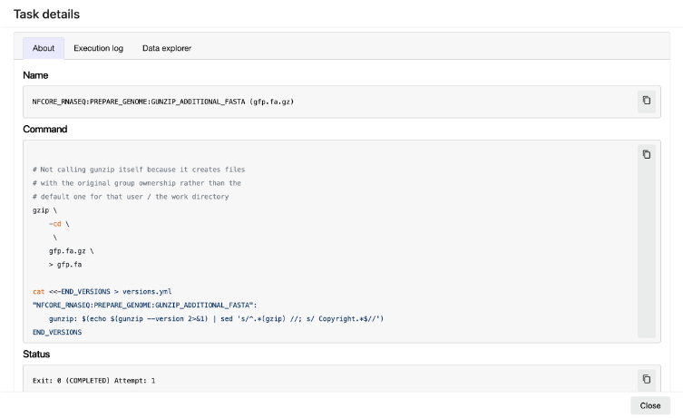
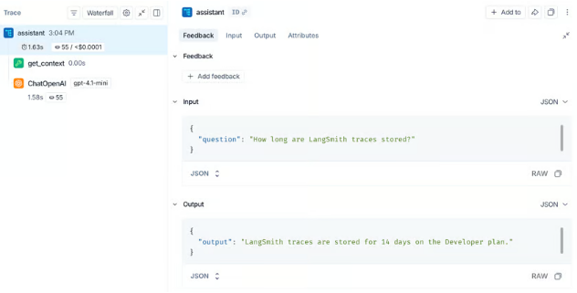

# Provenance patterns in notebook, science, and agent tools

Date: 2026-08-31

Status: **a research note, not a spec.** It does not approve a data model, a screen, or an implementation. It records product patterns that can inform later loci design work.

## Scope and reading guide

This note asks a practical question: when a person sees a result, how can they find what made it, what else used it, and what happened when an attempt failed?

**Observed** means the point comes from the linked product documentation or a captured product screen. **Inference for loci** means it is a design conclusion. It is not a claim about the product.

“Provenance” has two useful meanings:

- **Data provenance:** inputs, transformations, and outputs.
- **Run provenance:** work in one execution, including tools, parameters, duration, errors, and retries.

loci needs both. A table or document needs a stable origin story. An agent flow also needs the story of the particular attempt that made, changed, or failed to make it.

## Screens captured during the review

*Figure 1. Hex documents Graph view as a mirror of notebook logic. Selecting a cell shows its upstream and downstream cells and scrolls the notebook to it. Source: [Hex Graph view](https://learn.hex.tech/docs/explore-data/projects/project-execution/graph-view).*

*Figure 2. Galaxy makes a history the main work surface. Its ordered dataset list also exposes job state. Source: [Galaxy histories](https://training.galaxyproject.org/training-material/topics/galaxy-interface/tutorials/history/tutorial.html).*

*Figure 3. Seqera shows status counts before the task-table detail. It does not show a task row with duration and resources. Source: [Seqera run details](https://docs.seqera.io/platform-cloud/monitoring/run-details).*

*Figure 4. The screenshot shows a task name, command, and status. Other tabs make inputs, outputs, and logs available. Source: [Seqera run details](https://docs.seqera.io/platform-cloud/monitoring/run-details).*

*Figure 5. LangSmith shows one agent run as a nested trace. The selected span opens in a detail pane. Source: [LangSmith trace view](https://docs.langchain.com/langsmith/view-traces).*

## Comparison at a glance

| Product | Main provenance unit | Main view | A useful interaction | Limit for loci |
|---|---|---|---|---|
| Hex | notebook cell dependency | directed cell graph beside notebook | select a cell to highlight ancestors and descendants | It explains code flow, not the full life of a result. |
| Observable | reactive cell dependency and notebook revision | minimap and history pane | select a cell to see direct dependencies | It does not make failed runs a first-class history. |
| Deepnote | block dependency and project/run snapshot | dependency graph and versions sidebar | run a block with dependent blocks | A restore changes a project snapshot. |
| Databricks | governed data object and query lineage | catalog lineage graph | switch upstream or downstream from a table | It focuses on catalog objects and governed compute. |
| Galaxy | ordered analysis history and job-created dataset | history panel and dataset provenance | open a dataset to inspect the producing job | Large histories become long and linear. |
| Seqera | workflow run, task, and file | task list plus task detail | open a failed task for command, inputs, outputs, and logs | It is not an exploratory notebook. |
| DataLad | recorded command in a dataset revision | Git history and command record | rerun a past command | Its main interface is the command line. |
| LangSmith | request trace and nested run | trace tree plus span detail | select a tool or model run in the tree | It does not own durable workspace objects. |
| OpenAI Agents SDK | trace and parent/child spans | trace viewer in the dashboard | inspect a generation, tool call, handoff, or guardrail | It needs an application model for data objects. |
| Arize Phoenix | OpenTelemetry trace and spans | trace list, tree, and span queries | filter traces, then inspect spans and evaluations | It is observability infrastructure, not a user workspace. |

## Product findings

Each target persona below is a design reading of documented product scope, not a quoted vendor segment.

### Hex

**What it does.** Hex is a collaborative notebook for data analysis, apps, and reports.

**Target persona.** Data analysts and data teams who build and share interactive analyses.

**Why provenance matters.** They need to trace a result through its upstream cells before they trust or change it.

**Observed model.** Hex infers links between cells from variable references. Its Graph view is a visual mirror of notebook logic. Selecting a cell highlights its upstream ancestors and downstream descendants. Hex also scrolls the notebook to the selected cell. The user can hide imports and unlinked cells, combine or separate edges, drag nodes, and zoom. [Official documentation](https://learn.hex.tech/docs/explore-data/projects/project-execution/graph-view)

**Observed user flow.** A user sees a chart with an unexpected value. They select the chart cell in Graph view. Hex highlights the query and calculation cells that feed it. The notebook scrolls to the chart cell. The user follows the highlighted path upstream, edits a filter cell, and sees the graph update with the notebook.

**Strength.** The graph stays connected to the familiar linear notebook. Selection answers the immediate question: “what feeds this?”

**Limit.** A variable edge says that code depends on code. It does not say why a person chose a source, which agent made a claim, or whether a prior attempt failed.

**Inference for loci.** Keep the current object or notebook as the main surface. Offer a compact dependency map as a second surface. Selecting an object must also select and reveal it in the main content. Do not use a full graph as the only way to read provenance.

### Observable

**What it does.** Observable is a reactive notebook platform for data analysis, visualization, and publication.

**Target persona.** Data journalists, analysts, and developers who explore and explain data.

**Why provenance matters.** They need to see how a cell depends on its inputs and recover or fork a useful notebook state.

**Observed model.** Observable notebooks are made of cells. Its runtime uses cell dependencies to decide the order of data flow and execution. The Minimap lists cells and their dependencies. When a user focuses a cell, it shows direct links and shifts transitive dependencies. The History pane records changes and can restore earlier notebook versions. A user can fork a notebook to make an independent copy. [Minimap](https://observablehq.com/documentation/debugging/minimap) and [notebook history](https://observablehq.com/documentation/notebooks/) document these behaviors.

**Observed user flow.** A user edits a filter cell. The reactive notebook recalculates cells that depend on it. If the result is not useful, the user opens History and restores an earlier version. If they want an independent line of work, they fork the notebook to keep a separate branch.

**Strength.** Dependency navigation is small and local. Version history and forking make experimentation feel safe.

**Limit.** The dependency view focuses on named cell values. It does not show a durable chain through documents, imported files, agent prompts, or a separate recall store.

**Inference for loci.** Show direct parents and direct children by default. Let the user expand the path when needed. Preserve branch identity when a notebook is copied or spawned. Explain the relation in plain words, such as “uses table” or “spawned from”, not just an arrow.

### Deepnote

**What it does.** Deepnote is a collaborative notebook for data analysis and data science projects.

**Target persona.** Data scientists and analysts who work together in shared projects.

**Why provenance matters.** They need to run dependents safely and inspect the exact project state that produced a result.

**Observed model.** Deepnote parses notebook blocks to build a directed acyclic graph of variable dependencies. A user can run one block or that block with dependent blocks. The product also records project versions and keeps an immutable, read-only run snapshot after each run. Restoring an older project version first makes a snapshot of the current project. [Execution modes](https://deepnote.com/docs/execution-modes) and [version history](https://deepnote.com/docs/history) describe these behaviors.

**Observed user flow.** A user changes a SQL block. They choose “run dependent blocks”. Deepnote runs the selected block and the downstream blocks that need its values. The user later opens a run snapshot to see the notebook as it was when that execution occurred. They can preview a project version and restore it without losing the current state.

**Strength.** It separates two useful actions: recompute from a point, and inspect what a past run saw. The safe restore action makes the risk clear.

**Limit.** A project-wide restore fits a collaborative project. It does not directly solve the loci rule that Record moves in time while Recall stays current.

**Inference for loci.** A provenance panel should distinguish “this object now” from “this object at event 184”. The time travel screen must state that Recall is current and is not rolled back. A past execution should remain inspectable even when the current notebook has changed.

### Databricks Unity Catalog

**What it does.** Unity Catalog is a governance layer for data, AI, and analytics assets in Databricks.

**Target persona.** Data engineers, data stewards, and analysts who manage shared data platforms.

**Why provenance matters.** They need to identify data sources, assess downstream impact, and meet governance needs.

**Observed model.** Unity Catalog captures lineage for supported queries. Its graph can show which queries and files populate a table, which jobs and notebooks transform it, and which dashboards consume it. It can capture lineage down to columns. Catalog Explorer provides upstream and downstream views. Permission rules can mask nodes that the viewer cannot inspect. [Official documentation](https://docs.databricks.com/aws/en/data-governance/unity-catalog/data-lineage)

**Observed user flow.** A dashboard shows a bad number. The user opens the table in Catalog Explorer and chooses upstream lineage. They find the notebook or job that wrote the table. They then choose downstream lineage before changing the source, to see which other tables, jobs, and dashboards will be affected.

**Strength.** It supports both diagnosis and impact analysis. The graph includes source, transformation, and consumer objects. Column lineage gives a precise answer when table-level links are too broad.

**Limit.** A governed catalog can assume stable asset names, workspace permissions, and a known compute system. loci is local and has notebooks, documents, tables, and agent actions together.

**Inference for loci.** Treat the source object, the action, and the result object as separate things. A result-to-source view needs an upstream mode. A before-change view needs a downstream mode. Start at object level. Add column detail only where stored facts can support it.

### Galaxy

**What it does.** Galaxy is a web platform for accessible, reproducible scientific data analysis.

**Target persona.** Life-science researchers who run analyses without deep command-line skill.

**Why provenance matters.** They need to inspect inputs, tools, parameters, and failures behind each dataset.

**Observed model.** Galaxy places datasets in a History. Each output dataset records the job that made it. Users can inspect dataset provenance, job parameters, input datasets, tool versions, and job state. Galaxy can extract a workflow from the jobs behind a history. A history is ordered and is also the practical record of an analysis. [Dataset provenance API evidence](https://docs.galaxyproject.org/en/latest/lib/galaxy.webapps.galaxy.api.html#galaxy.webapps.galaxy.api.provenance) and [history tutorial](https://training.galaxyproject.org/training-material/topics/galaxy-interface/tutorials/history/tutorial.html) show this model.

**Observed user flow.** A researcher sees that an output file is red or failed in the History panel. They open it. Galaxy shows the tool job and its error. They fix a parameter, run the tool again, and a new output appears later in the same ordered history. They can inspect the successful output to find the tool, inputs, and parameters that made it.

**Strength.** State is visible without opening detail. The history order gives a clear story of what a person tried. The producing job makes output provenance concrete.

**Limit.** The linear stack hides relationships when a history has many branches, reused inputs, or non-linear analysis.

**Inference for loci.** Keep an ordered event story available. Use a clear status mark for failed, running, and completed actions. Do not hide failed attempts. Connect each output object to its producing event, inputs, parameters, and error when present.

### Seqera

**What it does.** Seqera monitors and manages Nextflow data workflows.

**Target persona.** Bioinformatics and data-platform teams that run repeatable pipelines.

**Why provenance matters.** They need to debug failed tasks and trace files across complex workflow runs.

**Observed model.** Seqera monitors Nextflow workflow runs. A run contains tasks. Task views show state, duration, resources, command, inputs, outputs, logs, and error data. Its newer data lineage feature records provenance at workflow and task levels and can trace files through the run. [Run details](https://docs.seqera.io/platform-cloud/monitoring/run-details) and [data lineage](https://docs.seqera.io/platform-cloud/data/data-lineage) describe these views.

**Observed user flow.** A pipeline run ends with failures. The user filters tasks by failed state. They open one task. They read the command, input and output paths, exit status, work directory, resource use, and logs. They correct the pipeline configuration and launch another run. The previous failed run remains available for comparison.

**Strength.** The list gives a fast answer to “what is wrong?” The task inspector holds the evidence needed to reproduce or debug it. Status stays visible before detail.

**Limit.** It is optimised for scheduled, repeated pipeline tasks. It does not model informal thought, documents, or an evolving hypothesis.

**Inference for loci.** Use the same two-level pattern for agent work: a compact flow list, then a focused inspector. Each attempted action should show input objects, tool or model, parameters, start and finish time, output objects, and an error or stop reason. Do not put all this detail on the canvas.

### DataLad

**What it does.** DataLad manages data and reproducible data workflows from the command line.

**Target persona.** Researchers and data engineers who use version control for datasets and code.

**Why provenance matters.** They need a record of commands, inputs, and outputs to repeat or audit derived data.

**Observed model.** DataLad records process provenance as structured data with a command, dataset ID, exit status, declared inputs, declared outputs, and working directory. The record lives with the dataset revision. `datalad rerun` can report or re-execute recorded commands. [Provenance capture](https://docs.datalad.org/en/latest/design/provenance_capture.html) and [`rerun`](https://docs.datalad.org/en/latest/generated/man/datalad-rerun.html) document the record and rerun behavior.

**Observed user flow.** A researcher runs a command that creates derived files. DataLad stores the command and its declared input and output paths with the resulting revision. Months later, the researcher requests a rerun report to see which recorded commands would run. They rerun one revision, or export the commands as a script instead.

**Strength.** The record is precise enough to repeat work. Inputs and outputs are explicit. The old record remains tied to the revision that produced it.

**Limit.** Exact commands alone do not explain an analyst's intent or whether an output supports a claim. It also expects command-line and version-control skill.

**Inference for loci.** An action record should keep reproducible facts where possible: inputs, parameters, selected model or tool version, output handles, and error state. Show a plain language summary first. Offer the exact structured record as a secondary detail.

### LangSmith

**What it does.** LangSmith helps teams develop, test, and monitor LLM applications.

**Target persona.** LLM application developers and AI engineers.

**Why provenance matters.** They need to find which retrieval, model, or tool step caused an answer.

**Observed model.** LangSmith records an LLM application request as a trace with nested runs. The trace view offers a tree, a timeline, inputs and outputs, metadata, timing, token use, errors, and links between parent and child runs. A run can represent a model call, tool call, chain, or agent step. [Trace view documentation](https://docs.langchain.com/langsmith/view-traces) and [trace data model](https://docs.langchain.com/langsmith/run-data-format) cover the main concepts.

**Observed user flow.** A user receives an unsupported answer. They open the trace for that request. The tree shows the agent's retrieval and tool calls. They select a retriever run and read the documents returned. They then select the model run and compare its prompt and answer. The user can identify whether retrieval, the model, or a tool caused the result.

**Strength.** A nested tree matches nested execution. The selected-span inspector avoids a dense graph. It makes a long agent run inspectable one step at a time.

**Limit.** The trace is a diagnostic record. It does not by itself say which durable notebook, table, or document a span changed.

**Inference for loci.** Use a trace tree for the inside of one agent action. Link trace outputs to the objects they created or changed. Keep object provenance and execution provenance connected, but do not merge them into one graph.

### OpenAI Agents SDK tracing

**What it does.** The OpenAI Agents SDK helps developers build agent workflows with models and tools.

**Target persona.** Developers who build multi-step AI agents.

**Why provenance matters.** They need to inspect agent steps, handoffs, and tool calls when a workflow fails or behaves unexpectedly.

**Observed model.** The Agents SDK records an end-to-end workflow as a trace. The trace contains parent and child spans. Built-in spans can record agent runs, generations, tool calls, handoffs, guardrails, and custom events. A trace has a workflow name, ID, optional group ID, and metadata. Spans have a parent link and start and end time. The trace viewer can inspect the run. The SDK warns that generation and function spans can contain sensitive input and output data. [Tracing](https://openai.github.io/openai-agents-python/tracing/) and [trace and span creation](https://openai.github.io/openai-agents-python/ref/tracing/create/) describe this model.

**Observed user flow.** A developer runs an agent that searches, calls a tool, hands work to a second agent, and returns an answer. They open the trace viewer. They select the failing tool span, read its parameters and error, then select the parent agent span to see the broader run. They use the group ID to find related traces from the same conversation.

**Strength.** It defines a small, general execution structure. Parent links give a reliable way to show nested work. Grouping connects related attempts without falsely making them one run.

**Limit.** It is an SDK-level trace model. It leaves object identity, durable event history, and the user interface of a workspace to the host application.

**Inference for loci.** A loci flow may use a trace-shaped internal record. The user should see only useful levels at first. Group related retries under a hypothesis or flow, but preserve a separate event for every record change.

### Arize Phoenix

**What it does.** Arize Phoenix is an observability tool for LLM applications.

**Target persona.** ML and AI engineers who evaluate and debug production LLM systems.

**Why provenance matters.** They need to compare traces across runs and connect poor outputs to the spans that caused them.

**Observed model.** Phoenix collects OpenTelemetry traces. A trace contains nested spans. Spans have timing and attributes. Phoenix identifies common LLM work as chain, retriever, reranker, LLM, embedding, agent, and tool spans. It can filter and query spans, join a span to its parent, and use span data for evaluations. [Trace concepts](https://arize.com/docs/phoenix/tracing/concepts-tracing/what-are-traces) and [span queries](https://arize.com/docs/phoenix/tracing/how-to-tracing/importing-and-exporting-traces/extract-data-from-spans) describe this use.

**Observed user flow.** A team sees an increase in bad answers. They filter traces by time and an evaluation result. They open a trace, select a retriever span, and compare its retrieved documents with the answer. They query span attributes to find other runs with the same model, tool, or failure pattern.

**Strength.** It supports both a single-run inspection and a search across many runs. The common span kinds give consistent labels.

**Limit.** It is built for development and operations. A person using loci needs a view grounded in their objects and questions, not an observability console.

**Inference for loci.** Add search and filters after the direct object path works. Useful filters include status, model or tool, source object, notebook, time, and hypothesis. The user should be able to find all failed runs that used a particular source without first understanding tracing.

## Cross-product patterns

### 1. Start from the thing the user already sees

Hex starts from a notebook cell. Databricks starts from a table. Galaxy starts from a history item. LangSmith starts from a request trace. The user does not first choose a graph type.

**Inference for loci.** Every result, source, notebook cell, and agent output needs a visible “show provenance” action. It should open with that item selected.

### 2. Use a compact overview and a detail inspector

Hex pairs a graph with a notebook. Seqera pairs a task list with task detail. LangSmith pairs a tree with a span inspector. These products do not ask one screen to show every fact.

**Inference for loci.** Put relation cues near objects. Put full evidence in a right-side inspector. Selecting any node, event, relation, or run should update that inspector. The inspector needs links to parent and child objects, not a dead end.

### 3. Keep status visible

Galaxy and Seqera show failed, running, and completed state in their primary lists. This lets a user decide where to look before reading logs.

**Inference for loci.** A failed flow must have a clear status label and an error summary. It must remain present after a successful retry. Do not replace a failed attempt with the later success.

### 4. Make direction explicit

Databricks supports both upstream diagnosis and downstream impact. Hex labels ancestors and descendants through selection. Direction answers two different questions.

| User question | Direction | Useful words in loci |
|---|---|---|
| “Where did this result come from?” | upstream | uses, derived from, produced by |
| “What will this change affect?” | downstream | used by, supports, feeds |
| “What happened inside this run?” | nested | step of, called, handed off to |
| “What else did I try?” | related | retry or branch (interface wording; design question) |

### 5. Separate a durable object from one execution

Databricks links catalog objects and jobs. Galaxy links output datasets and the job that made them. LangSmith and the Agents SDK show the nested events inside one run. The products use different records because the questions differ.

**Inference for loci.** One table version is an object. One table write is an event. A current flow is an object, and its transitions are Record events. A notebook may link to the object and to the flow that made it. The UI must make those distinctions visible.

### 6. Preserve the failed path

Seqera keeps failed tasks. Galaxy keeps failed history items. Trace systems retain errors inside a trace. DataLad records a non-zero exit value.

**Inference for loci.** A failure needs inputs, attempted action, error, stop time, and an optional human or agent note. A retry must point back to it. A later successful result must not make the older failure disappear.

### 7. Allow a safe return, but say what returns

Observable and Deepnote show versions and safe restore paths. DataLad reruns recorded work. These actions have different meanings.

**Inference for loci.** Time travel restores the Record view only. Recall remains current. The screen needs an explicit notice: “You are viewing Record at event 184. Recall is current.” This prevents a user from treating current agent memory as evidence from the past.

## Proposed user flows for loci

These flows use loci names from the current architecture. They are design examples, not API or screen requirements.

### Flow A: result to source

**Goal:** explain a chart or conclusion without making the user read a whole notebook.

1. The user opens a result object, such as a chart, table, or conclusion cell.
2. The user selects **Provenance**.
3. loci opens a right inspector with the result as the selected item.
4. The inspector says: “Produced by the `scenario-summary` table write.”
5. It lists direct inputs: a source table, a filter event, and the notebook cell that requested it.
6. The user selects the source table.
7. The map or breadcrumb shifts upstream. The inspector shows its source location, import event, schema, and table version handle.
8. The user expands one more relation at a time until they reach the imported file or connected source.

**Why this fits the research.** It uses the Hex and Databricks direction pattern. It uses the Seqera and LangSmith inspector pattern. It does not force a large graph on a simple question.

### Flow B: failed attempt while testing a hypothesis

**Goal:** retain useful negative work and make the next action informed.

1. A user asks the agent to test a hypothesis in a notebook.
2. loci creates a flow object with the hypothesis, selected inputs, and start time.
3. The agent query fails, times out, or returns evidence against the hypothesis.
4. loci records a transition as a Record event. **Failed** is execution state. “Did not support the hypothesis” is a conclusion from a completed flow, not a flow state.
5. The notebook shows a compact attempt card with status, one-line reason, and time.
6. The user opens the card. The inspector shows inputs, prompt or query, tool or model, trace steps, error or evidence, and produced objects if any.
7. The user selects **Try again from this attempt** or **Start a different approach**.
8. The new flow remains linked through the current Record relations or interface wording. The old attempt remains visible.

**Why this fits the research.** It applies Galaxy and Seqera status visibility. It applies LangSmith-style nested detail only when the user requests it. It prevents a success from erasing the history of a failed test.

### Flow C: retry or branch

**Goal:** distinguish a correction from a different line of inquiry.

1. The user opens a failed flow or a result they want to challenge.
2. loci presents two actions: **Retry with changes** and **Branch from here**.
3. Retry copies the selected inputs and declares the prior flow as its predecessor.
4. Branch starts from the selected Record event or notebook cell and asks for a new purpose.
5. The provenance map shows a short fork marker rather than duplicating all shared parents.
6. The inspector states the relation in interface wording: “This flow retries `flow-31` with a new threshold” or “This notebook was spawned from `Taiwan scenario analysis` at event 184.”
7. Shared inputs appear once. Each branch shows its own outputs and execution status. Each notebook opens current Recall through the current lineage rules.

**Why this fits the research.** It combines Observable forks with the trace group idea from the Agents SDK. It avoids the false claim that two flows are the same execution.

### Flow D: compare runs

**Goal:** answer why two attempts produced different results.

1. The user selects two flow cards, two table versions, or two notebook results.
2. loci opens **Compare** in the inspector.
3. The top line states the shared parent, if there is one.
4. A compact difference list shows changed inputs, prompt or query, model or tool, parameters, source versions, duration, status, and output handles.
5. The user selects a row, such as “source table version”.
6. loci shows the two source records and their upstream difference.
7. If outputs are tables, loci offers the existing table view for a data comparison. It does not pretend a sampled preview is the full table answer.
8. The user can save a short notebook note that explains the comparison conclusion.

**Why this fits the research.** Seqera supports task-level evidence. DataLad shows that a repeat needs declared inputs and outputs. Phoenix shows that span attributes become useful for comparison only after they are recorded consistently.

### Flow E: time travel with current Recall

**Goal:** inspect a past record without making Recall look historical.

1. The user opens a notebook or object and selects **View at event**.
2. loci shows an event slider or ordered event list.
3. The user chooses event 184.
4. loci folds Record through event 184 and molds the historical notebook or object view.
5. A persistent banner says: “Record at event 184. Recall is current.”
6. The inspector separates **Record evidence at event 184** and **Current Recall**.
7. A fact written after event 184 carries its current timestamp. It does not appear as an old record change.
8. The user selects **Return to present**. No Recall data changes.

**Why this fits the research.** Deepnote and Observable show the value of past views and safe returns. loci differs because Record and Recall have separate rules. The UI has to teach this at the moment it matters.

## A small UI vocabulary for later mockups

This is a proposed vocabulary. It is not a new storage model. Labels below are ordinary interface descriptions or design examples, not current fields unless the current relation name is shown.

| Item | What it represents | First detail to show |
|---|---|---|
| Object | notebook, cell, table version, document, or result | title, type, current state |
| Event | one Record change or `:tx` | action, time, actor, affected objects |
| Flow | one agent or user execution | status, purpose, start/end time, outputs |
| Step | part of a flow | tool/model, input summary, output summary, error |
| Relation | a typed link between two items | plain language label and direction |
| Recall fact | agent-written memory | fact text, subject, confidence/rank, current time |

The first mockup should use only a few relation labels. Current relation names include `:spawned-by`, `:merged-from`, and `:from`; the UI may show ordinary descriptions such as “spawned from”.

- `uses`
- `produced by`
- `derived from`
- `spawned from`
- `retry of` (design example; not a current field)
- `branch from` (design example; not a current field)
- `tests hypothesis` (design example; not a current field)
- `supports` (design example; not a current field)

Avoid a generic “related to” edge when a known relation exists. It hides the reason for the link.

## Design limits and open questions

- Which relations are already available from notebook references, `:spawned-by`, `:merged-from`, and `:from`?
- Which flow facts already exist in `loci.server`, `loci.agent`, and the event log?
- How should the flow object and its Record events appear together?
- Which errors and prompts can the app keep locally without exposing secret values?
- How should a relation appear when its parent object no longer has a present-day view?
- Does a user need a named hypothesis object, or is a notebook cell enough for the first version?
- Which comparison is meaningful for documents, tables, and agent answers respectively?

No answer is assumed here. Read the existing specs and source before making a design decision.

## Source index

All links below are official product documentation, except the Galaxy training material, which is from the Galaxy Training Network.

- [Hex Graph view](https://learn.hex.tech/docs/explore-data/projects/project-execution/graph-view)
- [Observable notebooks and history](https://observablehq.com/documentation/notebooks/)
- [Observable Minimap](https://observablehq.com/documentation/debugging/minimap)
- [Deepnote execution modes](https://deepnote.com/docs/execution-modes)
- [Deepnote version history](https://deepnote.com/docs/history)
- [Databricks Unity Catalog lineage](https://docs.databricks.com/aws/en/data-governance/unity-catalog/data-lineage)
- [Galaxy history tutorial](https://training.galaxyproject.org/training-material/topics/galaxy-interface/tutorials/history/tutorial.html)
- [Galaxy provenance API](https://docs.galaxyproject.org/en/latest/lib/galaxy.webapps.galaxy.api.html#galaxy.webapps.galaxy.api.provenance)
- [Seqera run details](https://docs.seqera.io/platform-cloud/monitoring/run-details)
- [Seqera data lineage](https://docs.seqera.io/platform-cloud/data/data-lineage)
- [DataLad provenance capture](https://docs.datalad.org/en/latest/design/provenance_capture.html)
- [DataLad rerun](https://docs.datalad.org/en/latest/generated/man/datalad-rerun.html)
- [LangSmith trace view](https://docs.langchain.com/langsmith/view-traces)
- [LangSmith trace data](https://docs.langchain.com/langsmith/run-data-format)
- [OpenAI Agents SDK tracing](https://openai.github.io/openai-agents-python/tracing/)
- [OpenAI Agents SDK trace and span creation](https://openai.github.io/openai-agents-python/ref/tracing/create/)
- [Arize Phoenix trace concepts](https://arize.com/docs/phoenix/tracing/concepts-tracing/what-are-traces)
- [Arize Phoenix span queries](https://arize.com/docs/phoenix/tracing/how-to-tracing/importing-and-exporting-traces/extract-data-from-spans)
